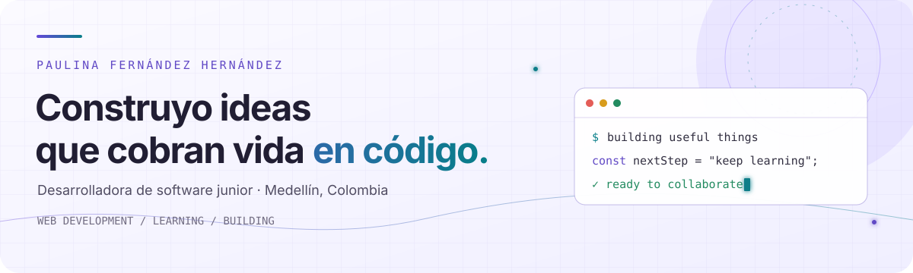
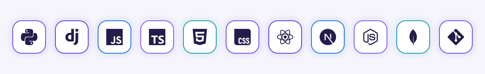

  <picture>
    <source media="(prefers-color-scheme: dark)" srcset="./assets/banner-dark.svg" />
    
  </picture>

  
  
  

  <a href="#sobre-mí">Sobre mí</a> &nbsp;·&nbsp;
  <a href="#tecnologías">Tecnologías</a> &nbsp;·&nbsp;
  <a href="#proyectos-destacados">Proyectos</a> &nbsp;·&nbsp;
  <a href="#actividad-en-github">Actividad</a> &nbsp;·&nbsp;
  <a href="#conectemos">Contacto</a>

## Sobre mí

Soy **Paulina Fernández Hernández**, desarrolladora de software junior y estudiante de **Análisis y Desarrollo de Software en el SENA**. Diseño y construyo soluciones web: interfaces responsive, lógica de negocio, APIs, integración de datos y pruebas.

Me interesa el desarrollo backend, la calidad de software y convertir problemas cotidianos en experiencias digitales útiles.

## Tecnologías

  <picture>
    <source media="(prefers-color-scheme: dark)" srcset="./assets/tech-stack-dark.svg" />
    
  </picture>

## Proyectos destacados

<table>
  <tr>
    <td width="50%" valign="top" style="padding: 8px;">
      <strong><a href="https://github.com/paulina01fdz/portfolioBook">Portfolio Book</a></strong> 
      Portafolio digital interactivo con navegación tipo libro, transiciones 3D y diseño responsive. Construido con Next.js, React, TypeScript y Framer Motion.  
      
      
      
    </td>
    <td width="50%" valign="top" style="padding: 8px;">
      <strong><a href="https://orbit-aplicacion.vercel.app/">ORBIT · Gestión de proyectos</a></strong> 
      Aplicación Kanban para organizar proyectos y tareas, con roles, estadísticas y gestión de actividades.  
      
      
      
    </td>
  </tr>
  <tr>
    <td width="50%" valign="top" style="padding: 8px;">
      <strong><a href="https://github.com/paulina01fdz/ALQUIPC-Proyecto">ALQUIPC · Sistema de facturación</a></strong> 
      Aplicación web para calcular alquileres de equipos, aplicar reglas de negocio y validar los datos de facturación.  
      
      
      
    </td>
    <td width="50%" valign="top" style="padding: 8px;">
      <strong><a href="https://github.com/paulina01fdz/mujeresDigitales-PF">Prácticas de frontend</a></strong> 
      Ejercicios y actividades para practicar fundamentos de desarrollo frontend, estructura web y estilos.  
      
      
      
    </td>
  </tr>
</table>

## Actividad en GitHub

  <picture>
    <source media="(prefers-color-scheme: dark)" srcset="https://github-readme-stats.vercel.app/api?username=paulina01fdz&show_icons=true&hide_border=true&include_all_commits=true&rank_icon=github&title_color=A99BFF&icon_color=A99BFF&theme=github_dark" />
    
  </picture>

  <picture>
    <source media="(prefers-color-scheme: dark)" srcset="https://github-readme-stats.vercel.app/api/top-langs/?username=paulina01fdz&layout=compact&hide_border=true&langs_count=8&title_color=A99BFF&theme=github_dark" />
    
  </picture>

  <picture>
    <source media="(prefers-color-scheme: dark)" srcset="https://streak-stats.demolab.com/?user=paulina01fdz&hide_border=true&background=0d1117&stroke=30363d&ring=A99BFF&fire=FF9B88&currStreakNum=f0f6fc&sideNums=58A6FF&currStreakLabel=A99BFF&sideLabels=c9d1d9&dates=8b949e" />
    
  </picture>

  <picture>
    <source media="(prefers-color-scheme: dark)" srcset="https://raw.githubusercontent.com/paulina01fdz/paulina01fdz/output/github-contribution-grid-snake-dark.svg" />
    
  </picture>

## Conectemos

¿Tienes una idea, oportunidad o proyecto en el que podamos colaborar? Me encantará conversar.

  
  
  

